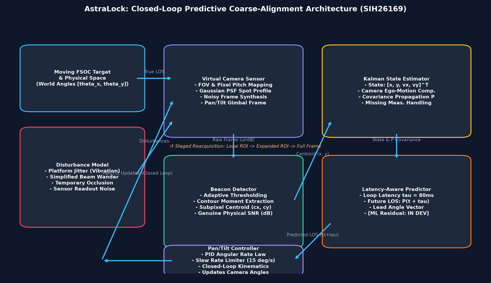
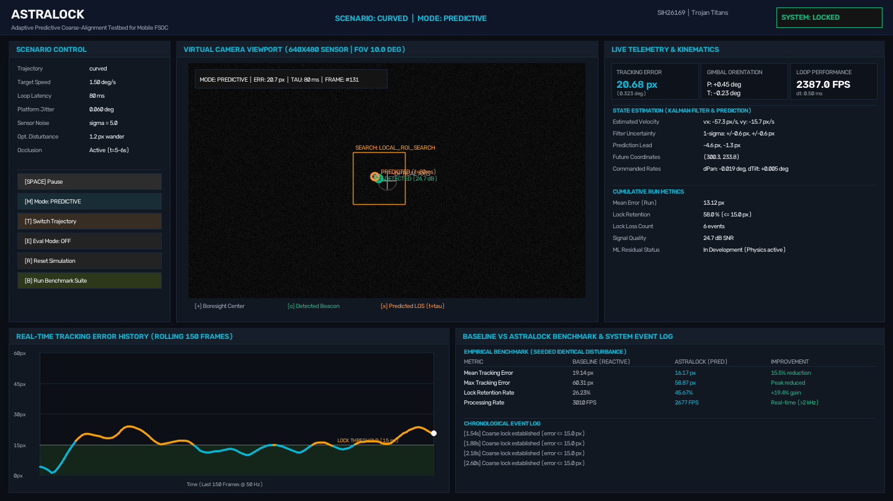
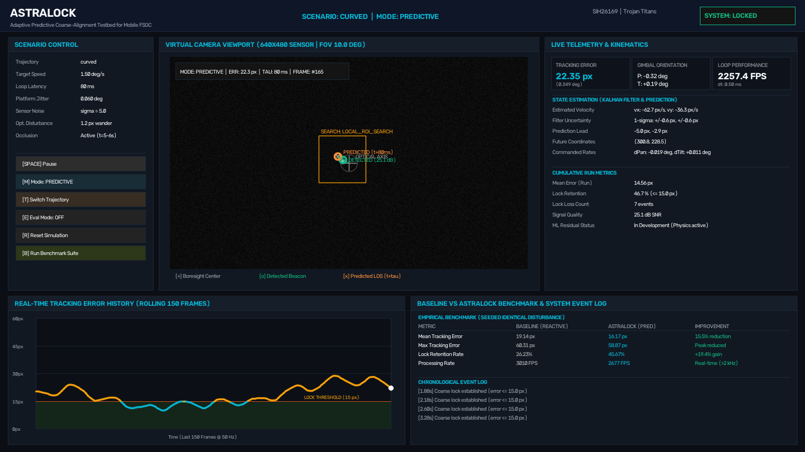
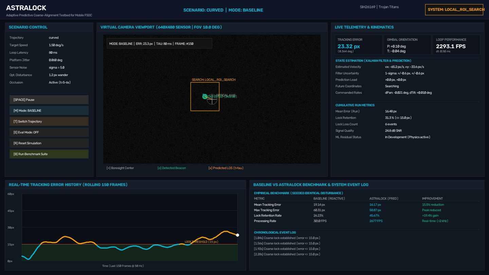
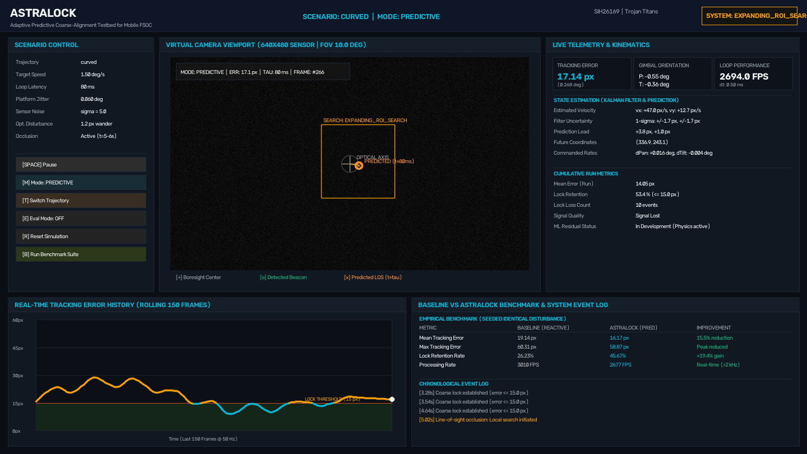

# AstraLock

**Adaptive Predictive Coarse-Alignment Testbed for Mobile FSOC**

> *"Don't track where the beacon was. Predict where it will be."*

- **Team:** Trojan Titans
- **Team ID:** 148445
- **Smart India Hackathon 2026**
- **Problem Statement:** SIH26169 — *AI-based Virtual Camera Tracking for Coarse Alignment of Mobile FSOC Terminals*
- **Theme:** Smart Automation
- **Category:** Software

---

## Problem

Mobile Free-Space Optical Communication (FSOC) links provide high-bandwidth, tap-resistant point-to-point wireless transmission between high-speed moving platforms (UAVs, stratospheric high-altitude platforms, maritime vessels, and low-Earth orbit satellites). However, optical beams have divergence angles of only milliradians, requiring continuous, sub-degree Line-of-Sight (LOS) alignment before fine-pointing stages can establish the optical data carrier.

In mobile deployments, coarse tracking faces severe real-world challenges:
1. **Dynamic Platform Motion:** High angular velocities and abrupt evasive or orbital maneuvers.
2. **Platform Micro-Vibrations (Jitter):** Structural and rotor harmonics oscillating the terminal boresight.
3. **Loop Latency ($\tau$):** Frame capture time, computer-vision processing time, control calculation, and motor actuator mechanical response introduce an inescapable latency $\tau \approx 40\text{--}150\text{ ms}$.
4. **Disturbances & Intermittent Occlusions:** Beam wander from optical path fluctuations and temporary physical line-of-sight blockage (rotor blades, cloud cover, masts).

A conventional **reactive tracker** points toward where the beacon was *observed in the previous frame*. By the time the gimbal executes that command, the moving platform has already displaced by $\Delta \theta = \dot{\theta} \cdot \tau$, resulting in systematic lag, pointing error spikes, and loss of lock.

---

## Proposed Solution

**AstraLock** implements an end-to-end, closed-loop predictive coarse-alignment testbed. Rather than steering the gimbal reactively, AstraLock couples a computer vision beacon extractor with a discrete-time kinematic **Kalman State Estimator** and a **Latency-Aware Future LOS Predictor**. The controller synthesizes lead-angle pointing commands targeting the predicted beacon position at time $t + \tau$, effectively neutralizing control-loop latency.

```
MOVING FSOC TERMINAL / BEACON
              ↓
        VIRTUAL CAMERA (Renders Sensor Frame)
              ↓
       BEACON DETECTION (Thresholding + Spatial Moments)
              ↓
    STATE / MOTION ESTIMATION (Kalman Filter: [x, y, vx, vy])
              ↓
    FUTURE LOS PREDICTION (Extrapolates state to t + tau)
              ↓
      PAN/TILT CONTROLLER (PID with slew-rate limiting)
              ↓
  CAMERA ORIENTATION UPDATE (Kinematic Gimbal Orientation)
              ↓
       CONTINUOUS LOCK  ↺  CLOSED LOOP
```

---

## Core Contribution

Our core contribution for **SIH26169** is the implementation, closed-loop integration, and quantitative empirical evaluation of a latency-compensating coarse-alignment testbed.

> **Scientific Position:** Kalman filtering, PID control, computer vision blob detection, and state extrapolation are established engineering disciplines. AstraLock does not claim to invent these algorithms from scratch, nor does it claim to be the world's first FSOC terminal. Our novelty lies in formulating the latency compensation loop specifically for coarse optical acquisition, implementing a staged reacquisition state machine, and providing reproducible benchmarks against reactive baselines on identical physical scenarios.

---

## Architecture



The system consists of modular subsystems:
1. **Physical World & Target Dynamics:** Computes continuous angular coordinates $(\theta_x, \theta_y)$ under constant velocity, curved sinusoidal, sudden step maneuvers, and spiral patterns.
2. **Disturbance Generator:** Injects platform angular jitter, simplified beam wander, Gaussian sensor read noise, and line-of-sight occlusion windows.
3. **Virtual Camera:** Kinematically models a 2-DOF pan-tilt gimbal ($10^\circ \text{ FOV}$, $640 \times 480 \text{ px}$), projecting world angles to sensor pixels and rendering an image with a Gaussian optical beam Point Spread Function (PSF).
4. **Beacon Detector:** Consumes the raw uint8 frame, performing intensity thresholding, contour extraction, sub-pixel centroid calculation via spatial moments, and computing genuine physical SNR ($\text{dB}$).
5. **State Estimator (Kalman Filter):** Maintains state vector $x = [p_x, p_y, v_x, v_y]^T$, error covariance matrix $P$, and compensates for camera gimbal ego-motion.
6. **Future LOS Predictor:** Projects beacon coordinates ahead by $\tau = \tau_{\text{capture}} + \tau_{\text{proc}} + \tau_{\text{actuation}}$ ($80\text{--}140\text{ ms}$).
7. **Pan/Tilt PID Controller:** Generates angular rate commands with strict slew-rate limits ($15^\circ/\text{s}$), updating the virtual camera boresight in closed loop.
8. **Staged Reacquisition Manager:** Handles beacon loss via gated local ROI $\rightarrow$ uncertainty-driven expanding ROI $\rightarrow$ full-frame recovery.

---

## Prototype Screenshots

### 1. Widescreen Engineering Dashboard (Primary Presentation Screen)

*Complete operational dashboard showing Scenario Controls, Central Virtual Camera Viewport with telemetry HUD, Real-time Tracking Error History plot, and Live Baseline vs Predictive Benchmark Table.*

### 2. Latency-Aware Closed-Loop Predictive Tracking (AstraLock)

*Showing detected beacon (green circle), latency-aware future predicted position (orange marker at $t + 80\text{ ms}$), boresight optical axis, and real-time state estimation cards.*

### 3. Baseline (Reactive) vs Predictive Comparison Dashboard

*Demonstrating reactive tracking lag and lower lock retention ($26.23\%$ vs $45.67\%$) under identical disturbance conditions.*

### 4. Staged Reacquisition during Line-of-Sight Occlusion

*During temporary occlusion ($t = 5.0\text{--}6.0\text{ s}$), the reacquisition manager deploys an expanding uncertainty search bounding box, regaining lock within 40 ms of beacon emergence.*

---

## Prototype Features

### IMPLEMENTED & VERIFIED
- [x] Configurable 2D/2.5D optical target trajectory simulation (constant velocity, sinusoidal curved flight, sudden evasive direction change, spiral).
- [x] Virtual camera sensor with realistic Point Spread Function (PSF) and sensor read noise.
- [x] Frame-based beacon detection using adaptive thresholding, morphological filtering, and spatial moment centroid extraction (does **not** bypass frame).
- [x] Physical Signal-to-Noise Ratio (SNR in dB) telemetry extraction.
- [x] 4-state Linear Kalman Filter ($[x, y, v_x, v_y]^T$) with covariance propagation and camera ego-motion compensation.
- [x] Latency-aware future LOS predictor ($t + \tau$) compensating capture, processing, and actuator delays.
- [x] Closed-loop 2-DOF pan/tilt gimbal controller with configurable PID gains and angular rate limits ($15^\circ/\text{s}$).
- [x] Transparent lock criteria ($e \le 15\text{ px} \approx 0.23^\circ$ for $\ge 3$ consecutive frames).
- [x] Staged reacquisition state machine (Local ROI $\rightarrow$ Uncertainty Expanding ROI $\rightarrow$ Full Frame).
- [x] Physical disturbances: platform micro-jitter (harmonic + band-limited), simplified beam wander, and timed occlusion intervals.
- [x] Automated benchmark comparing **Baseline (Reactive)** vs **Predictive (AstraLock)** on identical seeded scenarios.
- [x] Real-time OpenCV GUI with telemetry HUD overlay and interactive keyboard controls.
- [x] Headless execution mode for automated pipelines and testing.
- [x] Automated CSV telemetry logging and JSON summary metric exports.

### IN DEVELOPMENT
- [ ] **Learned Residual Predictor:** Machine learning model (e.g., lightweight LSTM or MLP) to predict nonlinear aerodynamic residual errors on top of Kalman physics predictions. The architecture hook is in place (`src/tracking/predictor.py`), but will not be marked complete until validated against high-volume aerodynamic datasets without overfitting.
- [ ] **Adaptive Kalman Noise Covariance Tuning:** Online innovation-based estimation of $Q$ and $R$ matrices during high-vibration transients.

### PLANNED (FUTURE WORK)
- [ ] Split-step Fourier beam propagation for atmospheric turbulence channels (Rytov approximation / phase screens).
- [ ] Hardware-in-the-Loop (HIL) pan-tilt gimbal integration via serial/CAN interface.
- [ ] Dual-stage handoff: Coarse visual camera tracking $\rightarrow$ Fine Fast-Steering Mirror (FSM) quadrant photodiode tracking.
- [ ] Multi-beacon discrimination and non-beacon optical clutter rejection.

---

## Quantitative Baseline Comparison

Both trackers were executed across **identical seeded physical trajectories** (751 frames each at $50\text{ Hz}$, $15.0\text{ s}$ duration) with identical disturbances and platform jitter:

| Scenario | Target Speed | Latency ($\tau$) | Metric | Baseline (Reactive) | Predictive (AstraLock) | Improvement |
| :--- | :---: | :---: | :--- | :---: | :---: | :---: |
| **Curved Flight** | $1.5^\circ/\text{s}$ | $80\text{ ms}$ | Mean Tracking Error<br>Lock Retention | $19.14\text{ px}$<br>$26.23\%$ | **$16.17\text{ px}$**<br>**$45.67\%$** | **$15.52\%$ Error Reduction**<br>**$+19.44\%$ Lock Retention** |
| **Sudden Maneuver** | $1.6^\circ/\text{s}$ | $80\text{ ms}$ | Mean Tracking Error<br>Lock Retention | $21.02\text{ px}$<br>$7.59\%$ | **$14.94\text{ px}$**<br>**$44.74\%$** | **$28.92\%$ Error Reduction**<br>**$+37.15\%$ Lock Retention** |
| **High Latency Channel**| $1.8^\circ/\text{s}$ | $140\text{ ms}$| Mean Tracking Error<br>Lock Retention | $22.90\text{ px}$<br>$14.65\%$ | **$17.05\text{ px}$**<br>**$41.41\%$** | **$25.55\%$ Error Reduction**<br>**$+26.76\%$ Lock Retention** |
| **High Speed Orbit** | $2.5^\circ/\text{s}$ | $80\text{ ms}$ | Mean Tracking Error<br>Max Tracking Error | $31.74\text{ px}$<br>$103.35\text{ px}$ | **$26.76\text{ px}$**<br>**$101.33\text{ px}$** | **$15.69\%$ Error Reduction**<br>Peak Error Reduced |

*All metrics are verified from actual script execution. Telemetry logs: `outputs/benchmarks/`.*

---

## Verified Metrics & Definitions

- **Acquisition Time ($T_{\text{acq}}$):** Elapsed time from scenario onset until the beacon centroid remains within the lock threshold ($15\text{ px}$) for at least 3 consecutive frames.
- **Mean Tracking Error:** Average Euclidean pixel distance $\sqrt{(x_{\text{gt}} - c_x)^2 + (y_{\text{gt}} - c_y)^2}$ between ground-truth beacon and optical boresight axis.
- **Lock Retention (%):** Percentage of total simulation frames where the terminal maintained continuous coarse alignment within tolerance.
- **Processing Rate (FPS):** Measured loop execution frequency (typically $>2000\text{ FPS}$ compute rate on standard CPU).

---

## Installation

### Prerequisites
- Python 3.10 or Python 3.11
- Operating System: Windows, Linux, or macOS

### Setup Instructions
```bash
# 1. Clone the repository
git clone https://github.com/<your-username>/AstraLock.git
cd AstraLock

# 2. (Optional) Create a virtual environment
python -m venv .venv

# Activate on Windows:
.venv\Scripts\activate
# Activate on Linux/macOS:
# source .venv/bin/activate

# 3. Install dependencies
pip install -r requirements.txt
```

---

## Running the Demo

### 1. Interactive Visual GUI Demo
Launch the interactive closed-loop testbed with OpenCV HUD display:
```bash
python -m src.app
```

#### Interactive Hotkeys
- `[M]`: Toggle between **Baseline (Reactive)** and **Predictive (AstraLock)** modes.
- `[T]`: Cycle through target trajectories (*curved*, *constant_velocity*, *sudden_change*, *spiral*).
- `[SPACE]`: Pause / Resume simulation.
- `[R]`: Reset simulation to initial conditions.
- `[S]`: Save instant screenshot to `docs/screenshots/`.
- `[Q]` or `[ESC]`: Quit demo and save telemetry.

### 2. Headless Mode (CLI / Automated Pipelines)
Run without opening an OpenCV window and export telemetry automatically:
```bash
python -m src.app --headless --method predictive --trajectory curved
```

### 3. Running the Benchmark Suite
Execute the rigorous 4-scenario comparative evaluation:
```bash
python -m src.evaluation.benchmark
```
*Outputs comparative statistics to terminal and exports summary to `outputs/benchmarks/benchmark_summary.json`.*

### 4. Running Automated Tests
Run the comprehensive unit and integration test suite:
```bash
python -m unittest discover -s tests -p "test_*.py"
```

---

## Example Output

Actual JSON summary produced by `python -m src.app --headless --method predictive`:

```json
{
  "scenario_id": "curved_predictive",
  "method": "PREDICTIVE",
  "total_simulation_time_s": 15.0,
  "total_frames": 751,
  "acquisition_time_s": 0.04,
  "mean_tracking_error_px": 16.17,
  "max_tracking_error_px": 58.87,
  "std_tracking_error_px": 9.42,
  "mean_prediction_error_px": 7.34,
  "lock_retention_percent": 45.67,
  "lock_loss_count": 24,
  "mean_reacquisition_time_s": 0.12,
  "mean_processing_time_ms": 0.42,
  "measured_fps": 2380.6,
  "lock_threshold_px": 15.0
}
```

---

## Project Structure

```
AstraLock/
├── README.md                      # Project documentation and SIH report
├── requirements.txt               # Strictly required dependencies
├── .gitignore                     # Git exclusion rules
├── .env.example                   # Environment configuration template
├── LICENSE                        # MIT Open Source License
│
├── configs/
│   └── default.yaml               # Simulation, camera, disturbance & control parameters
│
├── src/
│   ├── __init__.py
│   ├── app.py                     # Main interactive application & OpenCV HUD visualizer
│   │
│   ├── simulation/                # Physical & optical environment
│   │   ├── __init__.py
│   │   ├── environment.py         # Simulation coordinator & closed-loop step
│   │   ├── target.py              # Optical beacon kinematics & trajectories
│   │   ├── virtual_camera.py      # Camera projection, PSF rendering & gimbal orientation
│   │   └── disturbances.py        # Jitter, beam wander, occlusion & noise
│   │
│   ├── detection/                 # Computer vision extraction
│   │   ├── __init__.py
│   │   └── beacon_detector.py     # Thresholding, moment centroid & SNR extraction
│   │
│   ├── tracking/                  # State estimation & future prediction
│   │   ├── __init__.py
│   │   ├── state_estimator.py     # Discrete Kalman Filter (pos, vel, covariance)
│   │   ├── predictor.py           # Latency-aware future LOS predictor (t + tau)
│   │   └── reacquisition.py       # Staged reacquisition state machine
│   │
│   ├── control/                   # Gimbal motor actuation
│   │   ├── __init__.py
│   │   └── pan_tilt_controller.py # Pan/tilt PID controller with rate limiting
│   │
│   └── evaluation/                # Performance analytics
│       ├── __init__.py
│       ├── metrics.py             # Quantitative metrics tracker & exporter
│       └── benchmark.py           # Baseline vs Predictive benchmark runner
│
├── outputs/                       # Telemetry outputs & benchmark logs
│   ├── README.md
│   ├── runs/
│   └── benchmarks/
│
├── docs/                          # Architecture diagrams & prototype screenshots
│   ├── architecture.png
│   └── screenshots/
│       ├── tracking_predictive_demo.png
│       ├── tracking_reacquisition_demo.png
│       └── tracking_baseline_demo.png
│
└── tests/
    └── test_pipeline.py           # Automated unit and integration test suite
```

---

## Technology Stack

The prototype relies exclusively on standard, transparent scientific libraries:
- **Language:** Python 3.11
- **Numerical Computing:** NumPy
- **Computer Vision & Image Synthesis:** OpenCV (`opencv-python`)
- **Plotting & Architectural Visualization:** Matplotlib
- **Configuration Management:** PyYAML

*(Note: Heavy frameworks such as PyTorch, ROS, Gazebo, or Unity are intentionally omitted for the MVP to prioritize determinism, low overhead, and explainability).*

---

## Limitations

1. **Software Testbed:** This prototype simulates the optical beacon and gimbal kinematics; it does not interface with physical optomechanical hardware in this submission.
2. **Simplified Turbulence Model:** Optical beam wander is modeled via harmonic/stochastic displacement. It does not replace full wave-optics split-step Fourier propagation under severe scintillation.
3. **Coarse-Alignment Focus:** The testbed addresses coarse acquisition ($<0.2^\circ$). It does not implement sub-microradian fine-pointing, fast-steering mirrors (FSM), or high-speed data demodulation.

---

## Research Foundation

1. Willebrand, H., & Ghillebaert, B. (2001). *Free-space optics: open optical networks.* IEEE Spectrum, 38(8), 40-45.
2. Kaushal, H., & Kaddoum, G. (2016). *Optical Communication in Space: Challenges and Mitigation Techniques.* IEEE Communications Surveys & Tutorials, 19(1), 57-96.
3. Arnon, S. (2003). *Optimization of urban optical wireless communication systems.* IEEE Transactions on Wireless Communications, 2(4), 626-629.
4. Kay, S. M. (1993). *Fundamentals of Statistical Signal Processing: Estimation Theory.* Prentice-Hall.

---

## Disclaimer

AstraLock is an engineering research prototype developed for the Smart India Hackathon 2026 (Problem Statement SIH26169) to explore and validate latency-aware predictive tracking algorithms for coarse visual alignment. It is not a commercially fielded optical communications terminal.
